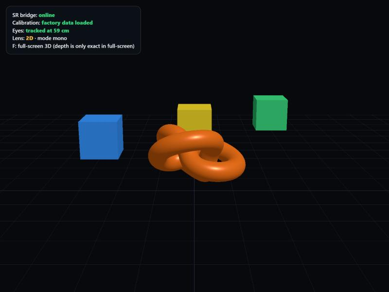
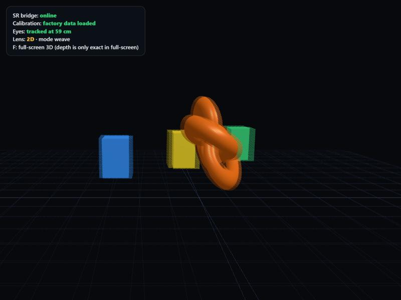
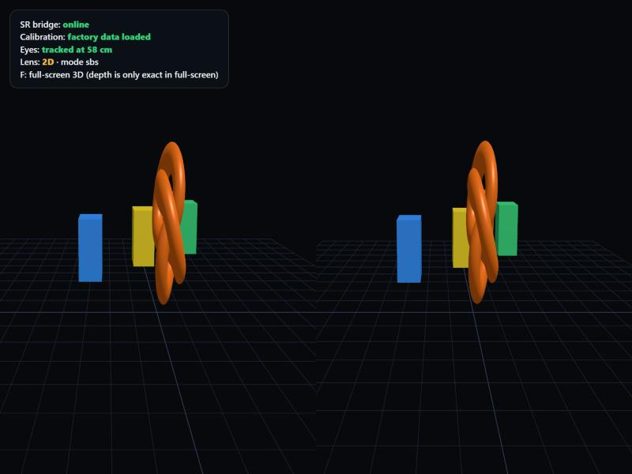

# Odyssey 3D starter

Glasses-free 3D on the **Samsung Odyssey 3D (G90XF)** from a plain web page (three.js).

The weave matches the official LeiaSR weaver: on the same pixels, 93–99.7 % of subpixels show the
same eye's view (99.7 % with the head still). You can re-run that check yourself.

| 2D | Woven for the lens | Side by side |
|---|---|---|
|  |  |  |

The middle picture is what the panel receives. Through the lens, each eye sees its own view.

## Run it

1. Plug the monitor's **USB upstream cable** into the PC (it carries the eye-tracking camera).
2. In Samsung's **Odyssey 3D Hub** app, turn off **"Convert to 3D in full screen"**. Otherwise the
   Hub converts the full-screen page by itself a few seconds after it opens and draws over it:
   no depth, and nothing tells you why.
3. Double-click `Start-Odyssey3D.bat`. It installs the npm packages on first run, starts the
   bridge and the web server, and opens the page full-screen on the 3D monitor.
4. You should see an orange knot in front of the screen and three cubes behind it.

Keep the minimised Python window open: it is the bridge to the monitor.

Needs Windows, the LeiaSR runtime (ships with the monitor), Python 3, Node.js, Chrome or Edge.

## Keys

| Key | Action |
|---|---|
| `F` | Full-screen 3D (the lens is only on in full-screen) |
| `1` `2` `3` `4` | Weave · side by side · anaglyph · 2D |
| `T` | Test pattern: left eye sees red, right eye sees cyan |
| `[` `]` | Phase −/+ · `X` swap eyes · `H` hide the status box |

## Make it yours

Replace `buildScene()` in `src/main.ts` with your own three.js scene. Leave the rest: it keeps the
canvas pixel-exact, follows your eyes and drives the lens.

## Check the 3D without looking at it

```
python sr-bridge\sr_bridge.py --probe     # 0 = calibrated, 2 = monitor not identified, 1 = no runtime
python tools\verify_weave.py              # needs numpy; sit still in front of the monitor
python tools\verify_page.py               # needs numpy and Pillow
```

- `verify_weave.py` lets the official weaver draw a red/cyan rectangle for three seconds and
  compares it with this project's formula.
- `verify_page.py` opens the real page full-screen, grabs the screen and checks what the panel
  actually receives. It catches what the first one cannot: the browser, scaling, and anything
  drawn over the page.

Both print an `agreement`: near 0.5 means wrong, above 0.9 means right.

## What is inside

| Path | What it does |
|---|---|
| `src/main.ts` | The page: your scene, the frame loop, the keys |
| `src/odyssey3d/` | Bridge client, off-axis stereo cameras, weave shader |
| `sr-bridge/sr_bridge.py` | Bridge between the LeiaSR runtime and the page |
| `tools/verify_weave.py` | Compares the weave formula with the official weaver |
| `tools/verify_page.py` | Checks what the real page puts on the real panel |
| `docs/display-3d.md` | How the display works, the rules, known failures |
| `AGENTS.md` | Rules and a ready-made prompt for an AI coding agent |

MIT licence. Not affiliated with Samsung or Leia. Tested on one G90XF with LeiaSR runtime 1.36.4.
